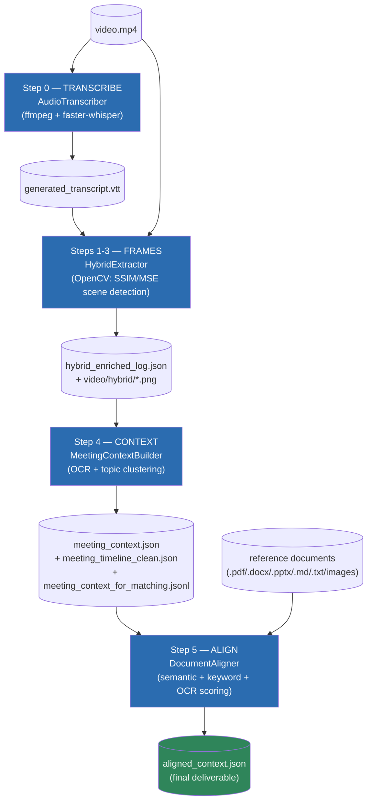
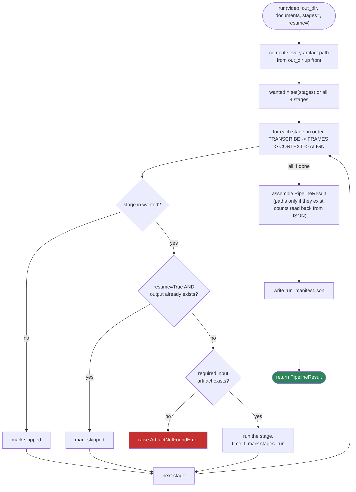
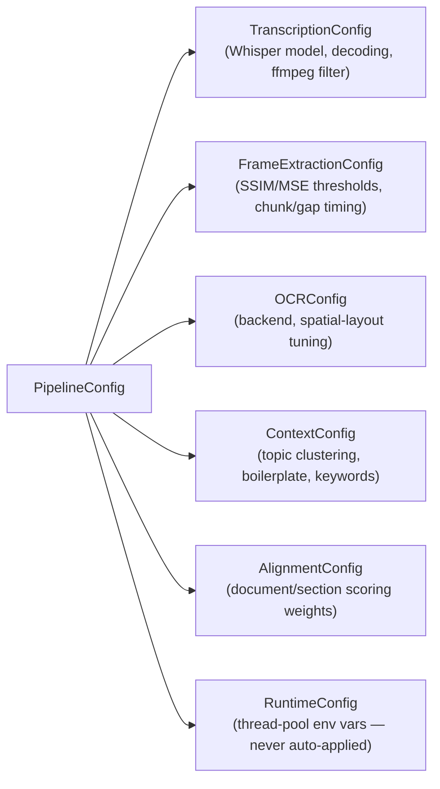
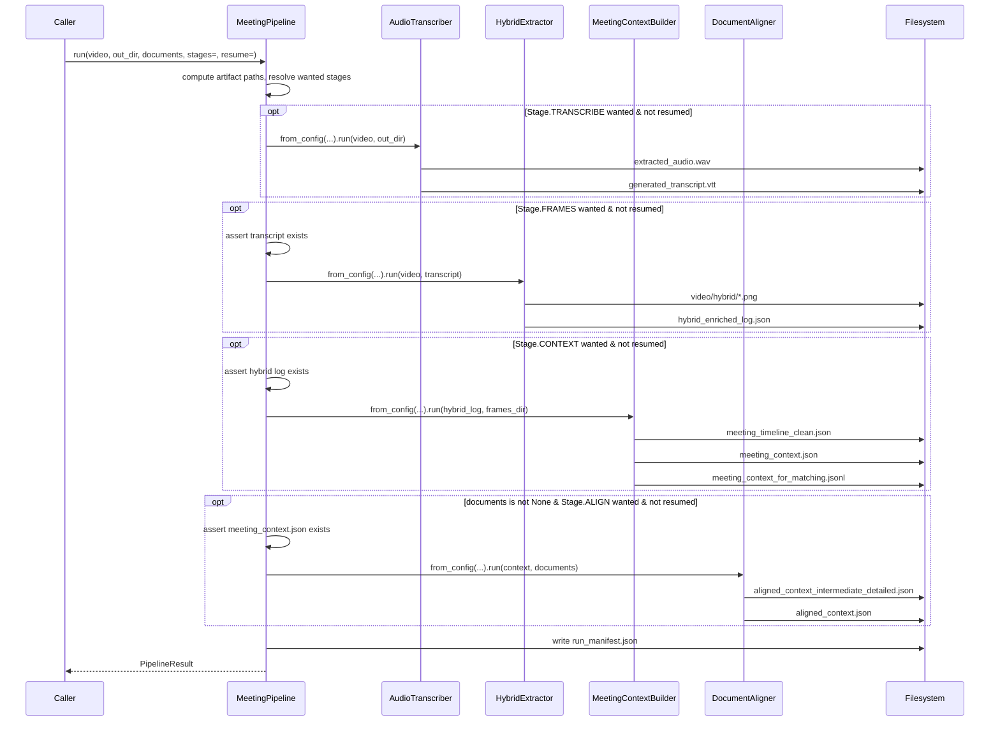
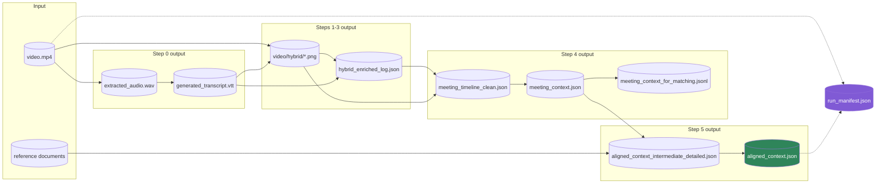
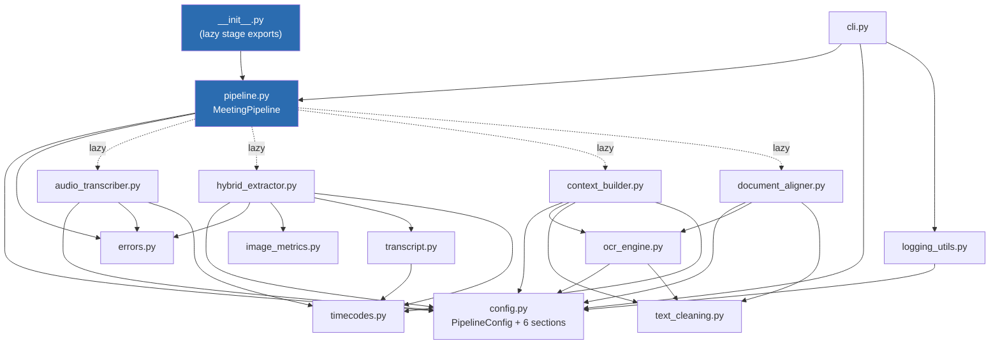

# Meeting Pipeline — Full Process Overview

This document is the top-level map of how `meeting-pipeline` works end to
end. It ties together the four per-stage deep-dives, the orchestration
layer that runs them, the full artifact data flow, and the technology stack
behind the whole system. For stage-by-stage internals, see:

- [`transcribe_stage.md`](transcribe_stage.md) — Step 0: audio extraction + speech-to-text
- [`frames_stage.md`](frames_stage.md) — Steps 1-3: keyframe extraction
- [`context_stage.md`](context_stage.md) — Step 4: OCR + topic clustering
- [`align_stage.md`](align_stage.md) — Step 5: reference document alignment

Related reference docs: [`architecture.md`](architecture.md) (design
rationale), [`configuration.md`](configuration.md) (every tunable field),
[`outputs.md`](outputs.md) (full JSON schemas), [`ocr_backends.md`](ocr_backends.md)
(OCR backend selection).

## 1. What this is

`meeting-pipeline` converts a meeting recording into structured,
topic-aligned, multimodal context, then correlates that context against a
caller-supplied set of reference documents. It runs entirely locally and
CPU-friendly — no LLM API calls, no cloud services. The only "AI" involved
is a local Whisper speech-to-text model, a local sentence-embedding model,
and a classical OCR backend; everything else (frame selection, topic
boundaries, scoring) is deterministic, hand-tuned logic on top of those
three models' outputs.

## 2. Design philosophy

These four principles show up repeatedly across every stage and are worth
internalizing before reading the code:

- **Time is the primary key.** Every artifact carries `start_sec`/`end_sec`.
  There is no separate alignment engine bolted on afterward — timestamps
  are the join key from the very first stage onward (`architecture.md`).
- **File-based hand-off, not in-memory chaining.** Each stage reads the
  previous stage's output file from disk and writes its own. This is what
  makes `stages=`/`resume=` possible: any stage can be rerun in isolation
  against already-generated artifacts.
- **Heavy dependencies load lazily, on demand.** Importing `meeting_pipeline`,
  constructing a `MeetingPipeline`, or inspecting a `PipelineConfig` never
  pulls in `torch`, `opencv`, `faster-whisper`, or any OCR backend — those
  only load inside the specific method that actually needs them.
- **Every tunable is a named, documented config field**, not a magic
  number. `PipelineConfig`'s six sections replace ~25 originally-hardcoded
  values from the internal predecessor project this package was extracted
  from, all preserving their originally-tuned defaults exactly.

## 3. High-level architecture

## 4. The four stages at a glance

| # | Stage | Class | Reads | Writes | Core technique | Details |
|---|---|---|---|---|---|---|
| 0 | `TRANSCRIBE` | `AudioTranscriber` | `video.mp4` | `extracted_audio.wav`, `generated_transcript.vtt` | ffmpeg extraction + local `faster-whisper` decoding with anti-hallucination settings | [transcribe_stage.md](transcribe_stage.md) |
| 1-3 | `FRAMES` | `HybridExtractor` | `video.mp4`, `generated_transcript.vtt` | `video/hybrid/*.png`, `hybrid_enriched_log.json` | Audio-anchored sampling + silent-gap MSE scanning, 3-layer SSIM dedup | [frames_stage.md](frames_stage.md) |
| 4 | `CONTEXT` | `MeetingContextBuilder` | `hybrid_enriched_log.json` | `meeting_timeline_clean.json`, `meeting_context.json`, `meeting_context_for_matching.jsonl` | OCR + spatial decomposition, temporal/semantic topic clustering, boilerplate filtering | [context_stage.md](context_stage.md) |
| 5 | `ALIGN` | `DocumentAligner` | `meeting_context.json`, reference docs | `aligned_context_intermediate_detailed.json`, `aligned_context.json` | Two-stage (document → section) composite scoring: semantic + keyword + OCR overlap | [align_stage.md](align_stage.md) |

## 5. Orchestration layer

Source: `src/meeting_pipeline/pipeline.py`. This is the part of the codebase
that has no per-stage document of its own (it isn't a "stage"), so it's
covered here in full.

### 5.1 Core types

- **`Stage(str, Enum)`** — `TRANSCRIBE`, `FRAMES`, `CONTEXT`, `ALIGN`, in
  execution order. Used both to select a subset of stages to run and to
  record which ones ran vs. were skipped.
- **`MeetingPipeline`** — holds one `PipelineConfig`; exposes both a
  single `run()` entry point and four individual per-stage methods
  (`transcribe`, `extract_frames`, `build_context`, `align_documents`),
  each of which lazy-imports its stage class, builds it via `from_config`,
  and delegates.
- **`PipelineResult`** — every artifact path (only populated if the file
  actually exists on disk), summary counts (segments/topics/frames/aligned
  topics, read back out of the written JSON), per-stage timings, and the
  exact `PipelineConfig` used. Serialized to `run_manifest.json` on every run.

### 5.2 Stage selection and resume logic

Two details worth calling out:

- **ALIGN is conditionally skipped regardless of `stages=`** if the caller
  passes `documents=None` — you can't align against nothing, so this isn't
  treated as an error, just a no-op.
- **`copy_documents=True`** (opt-in) copies the caller's reference documents
  into `out_dir/docs_input/` before aligning — a library shouldn't silently
  duplicate a caller's files by default, so this is off unless requested.

### 5.3 `PipelineConfig`

One dataclass per stage's tunables, bundled into a single top-level
container:

`PipelineConfig.from_json()`/`to_json()` round-trip the whole tree;
`.replace(section={"field": value})` produces a modified copy without
mutating the original — used internally by the CLI's `--flag` overrides
(`config_from_args()` in `cli.py`), which apply on top of an optional
`--config` JSON file, on top of built-in defaults. Full field reference:
[`configuration.md`](configuration.md).

### 5.4 CLI

`meeting-pipeline` (or `python -m meeting_pipeline`) exposes `run` (full or
partial pipeline), plus `transcribe`/`frames`/`context`/`align` for running
one stage directly against explicit input paths — useful for debugging a
single stage without the artifact-path bookkeeping `run()` does
automatically. `main()` calls `apply_thread_env(config.runtime)` before
touching any stage, since the package itself never mutates `os.environ` on
import (a known CTranslate2/PyTorch thread-pool deadlock workaround — see
the README's Troubleshooting section).

## 6. Full pipeline sequence diagram

## 7. Full artifact / data-flow map

Every file the pipeline can produce, and which stage produces / consumes it:

`meeting_context_for_matching.jsonl` is a slim search index but is **not**
currently consumed by Step 5 — `DocumentAligner` reads `meeting_context.json`
directly. The `.jsonl` file exists for external tooling/inspection.

## 8. Module dependency graph

How the 16 source modules depend on each other internally:

Notice `ocr_engine.py` is shared between `context_builder.py` (OCR on
extracted video keyframes) and `document_aligner.py` (OCR on image-format
reference documents) — one backend-fallback implementation, two call sites,
guaranteeing both stages treat images identically.

## 9. Technology stack summary

| Dependency | Stage(s) | Role |
|---|---|---|
| **ffmpeg** (system CLI) | TRANSCRIBE | Audio extraction/filtering from the source video. |
| **faster-whisper** | TRANSCRIBE | Local speech-to-text decoding. |
| **opencv-python** (`cv2`) | FRAMES | Video I/O, all classical vision math (SSIM/MSE/Laplacian/Sobel), frame saving. |
| **numpy** | FRAMES, CONTEXT, ALIGN | Array math backing image metrics, embedding cosine similarity, centroid updates, similarity matrices. |
| **webvtt-py** | FRAMES | Parses the Step 0 VTT into speech chunks. |
| **sentence-transformers** (`torch`-backed) | CONTEXT (optional), ALIGN (required) | Embeds text for semantic-similarity signals — topic-boundary drift detection in Step 4, topic/document/chunk scoring in Step 5. |
| **yake** | CONTEXT, ALIGN | Unsupervised keyword extraction, feeding the keyword-Jaccard scoring signal and `searchable_query` text. |
| **rapidocr-onnxruntime / paddleocr / easyocr / pytesseract** (one, auto-selected) | CONTEXT, ALIGN | Extracts visible text from video keyframes and image-format reference documents, via the shared `OCREngine`. |
| **pymupdf** (`fitz`) | ALIGN | `.pdf` reference document ingestion. |
| **python-docx** | ALIGN | `.docx` reference document ingestion. |
| **python-pptx** | ALIGN | `.pptx` reference document ingestion (soft-optional). |
| **pillow** | CONTEXT, ALIGN (via `ocr_engine.py`) | Image dimension reads for OCR box normalization; Tesseract's expected input type. |

No dependency here ever makes a network call — everything runs against
local files and locally-loaded models. See the earlier conversation in this
session for a deeper comparison against cloud-embedding/vector-DB
alternatives and why they weren't chosen for this architecture.

## 10. Error handling across stages

All exceptions derive from `MeetingPipelineError` (`errors.py`):

| Exception | Raised by | Meaning |
|---|---|---|
| `FFmpegNotFoundError` | `AudioTranscriber.extract_audio` | `ffmpeg` isn't on `PATH`. |
| `FFmpegError` | `AudioTranscriber.extract_audio` | `ffmpeg` ran but exited non-zero on both the filtered and fallback attempts. |
| `VideoOpenError` | `HybridExtractor.run` | OpenCV couldn't open the video file at all. |
| `MissingDependencyError` | (available for use by any stage) | An optional dependency (e.g. an OCR backend) is required but absent — currently OCR degrades gracefully instead of raising this, but the type exists for stricter use. |
| `ArtifactNotFoundError` | `MeetingPipeline.run` | A stage's expected input artifact is missing on disk (e.g. running `Stage.FRAMES` without a transcript already present). |

Beyond these hard failures, most optional-dependency gaps (missing
`yake`, a failed embedding-model load, an unsupported document type, a
single malformed reference document) are caught locally and logged, letting
the run continue in a degraded mode rather than aborting — see each stage
document's "Error handling" section for specifics.

## 11. Roadmap / known gaps

Real, documented gaps relative to a fuller "meeting intelligence" system —
not silently missing behavior. Full list and rationale in
[`architecture.md`](architecture.md#roadmap--not-implemented):

- No screen-type classification (presentation/code/terminal/whiteboard).
- No vision-language-model understanding beyond OCR text.
- No semantic event typing (Decision/Action Item/Question, etc.).
- No rendered meeting notes — the terminal artifact is structured JSON.
- No diagram generation from extracted entities.
- Fixed sampling density, not adaptive to detected topic transitions.
- No persisted vector search index — embeddings are transient, per-run.
