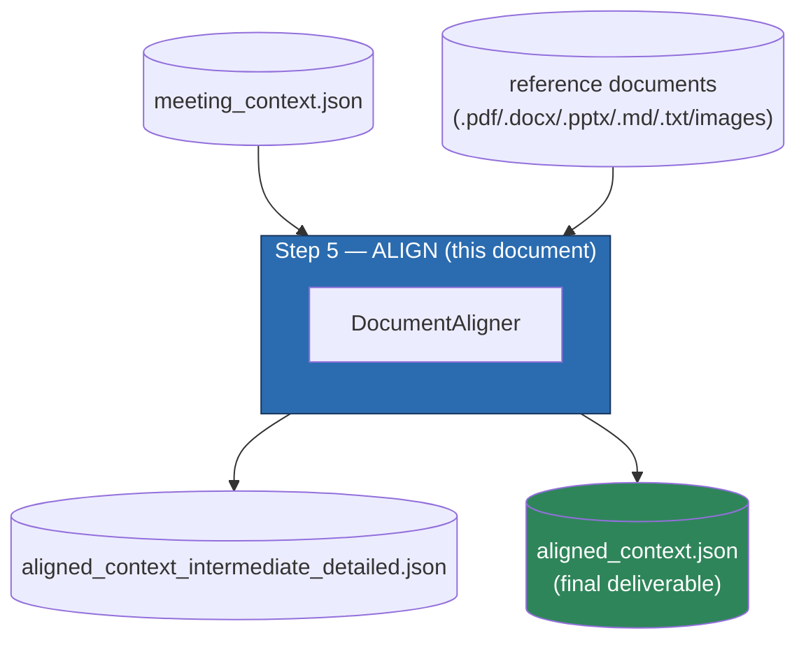
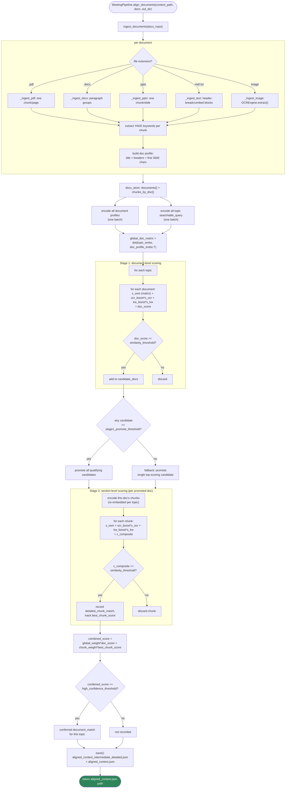
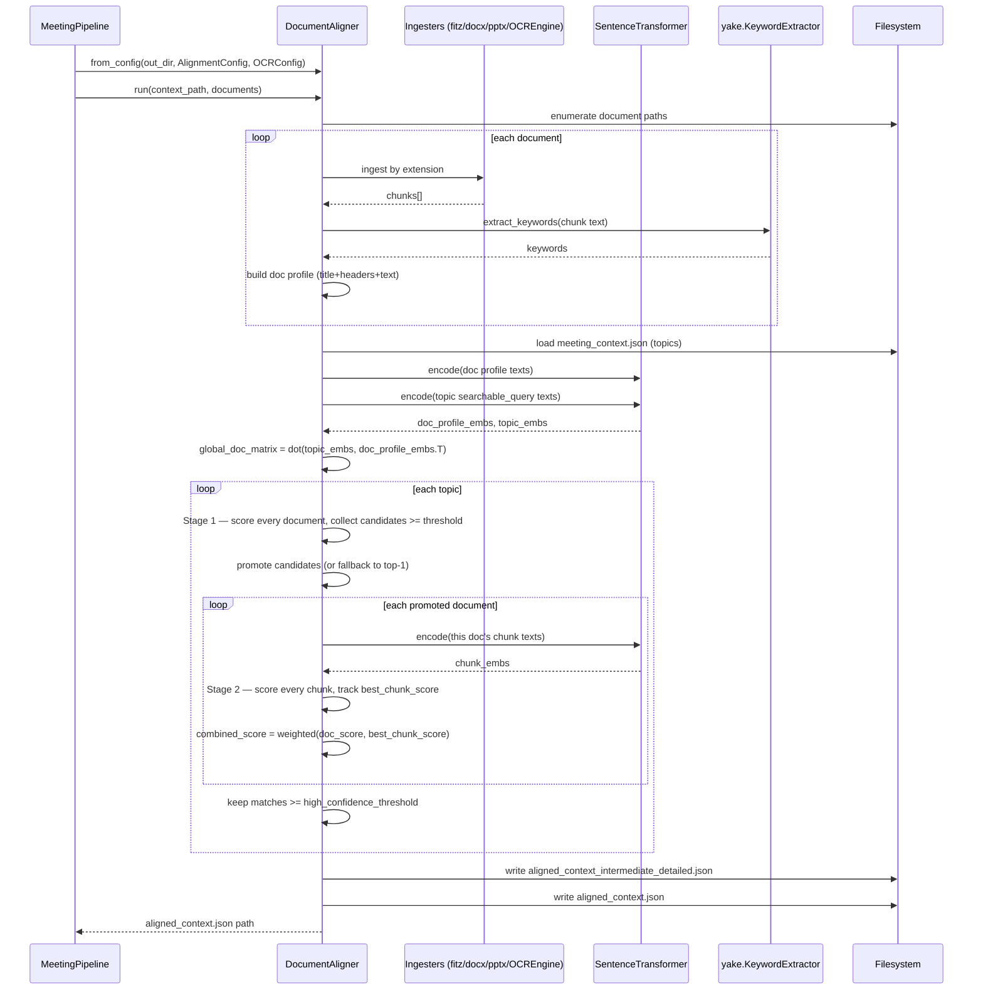

# Step 5: Document Alignment (`DocumentAligner`)

Source: `src/meeting_pipeline/document_aligner.py`
Supporting modules: `ocr_engine.py`, `text_cleaning.py`
Config: `AlignmentConfig` + `OCRConfig` (`src/meeting_pipeline/config.py`)
Orchestrated by: `MeetingPipeline.align_documents()` (`src/meeting_pipeline/pipeline.py`)

## 1. Purpose

`DocumentAligner` is the final stage: it takes the per-topic multimodal
context built in Step 4 (`meeting_context.json`) and **reverse-aligns** each
topic against a set of external reference documents (specs, slide decks,
design docs) supplied by the caller. "Reverse" because the direction of
search is topic → document, not document → topic: for every meeting topic,
it asks "which of these documents was this topic actually about, and which
section of it?"

Matching uses three independent signals combined into one composite score:

1. **Semantic cosine** (sentence-transformers embeddings of topic query vs.
   document text).
2. **Keyword Jaccard** (YAKE keyword-set overlap).
3. **OCR text overlap** (does text visible on screen during the topic
   actually appear in the document, with slide *titles* weighted heavily).

Scoring runs in **two stages** — a coarse whole-document pass, then a
zoomed-in section/chunk pass only within the documents that cleared the
first bar — which is the architectural core of this stage (see §8).

## 2. Where it fits in the pipeline



## 3. Dependencies

### Python packages

| Package | Import site | Used for |
|---|---|---|
| **sentence-transformers** | `from sentence_transformers import SentenceTransformer` — imported **unconditionally** in `__init__`, not behind a try/except | Embeds document profiles, topic queries, and document chunks for cosine-similarity scoring. Unlike `MeetingContextBuilder`, this stage has no time-based fallback if embeddings are unavailable — semantic similarity is one of the three signals every score is built from, so `DocumentAligner()` will simply fail to construct if the package/model can't load. |
| **yake** | `import yake` (lazy, inside `__init__`, wrapped in try/except) | Keyword extraction for documents/chunks, used for the keyword-Jaccard signal. Optional — if unavailable, that signal just contributes 0. |
| **numpy** (`np`) | module top | The global topic×document similarity matrix (`np.dot(topic_embs, doc_profile_embs.T)`) and per-topic chunk similarity vectors (`np.dot(chunk_embs, topic_embs[i])`). |
| **pymupdf** (`fitz`) | `_ingest_pdf` (lazy) | Opens `.pdf` files, extracts per-page text. |
| **python-docx** (`docx`) | `_ingest_docx` (lazy) | Reads `.docx` paragraph-by-paragraph. |
| **python-pptx** (`pptx`) | `_ingest_pptx` (lazy, soft-fail) | Reads `.pptx` slide text. Uniquely among the ingesters, this one catches its own `ImportError`, logs a warning, and returns `[]` instead of propagating — a missing optional dependency skips that file type rather than crashing the whole ingestion pass. |

### Internal (sibling modules)

| Module | Symbol(s) | Used for |
|---|---|---|
| `config.py` | `AlignmentConfig`, `OCRConfig` | Every scoring weight/threshold, plus OCR backend config for image-document ingestion. |
| `ocr_engine.py` | `OCREngine` | Same auto-fallback OCR wrapper used in Step 4 — reused here (not reimplemented) to OCR `.png`/`.jpg`/`.jpeg` reference documents (diagrams, exported slides, whiteboard photos). |
| `text_cleaning.py` | `clean_ocr_text`, `normalize_whitespace`, `token_set` | Text normalization for ingested document text and the tokenization used by the OCR-overlap scorer. |

## 4. Configuration (`AlignmentConfig`)

| Field | Default | Purpose |
|---|---|---|
| `similarity_threshold` | `0.25` | Minimum composite score for a document (Stage 1) or chunk (Stage 2) to even be considered a candidate. |
| `high_confidence_threshold` | `0.45` | Minimum **combined** (document+chunk) score for a document to be recorded as a confirmed match on a topic. |
| `stage1_promote_threshold` | `0.40` | Minimum Stage 1 document score to be promoted into Stage 2's chunk-level scoring. |
| `ocr_boost_weight` | `0.35` | Weight applied to the OCR-overlap signal in the composite score. |
| `keyword_boost_weight` | `0.15` | Weight applied to the keyword-Jaccard signal. |
| `global_score_weight` | `0.60` | Weight of the Stage 1 document score in the final combined score. |
| `chunk_score_weight` | `0.40` | Weight of the best Stage 2 chunk score in the final combined score. |
| `title_containment_threshold` | `0.60` | Minimum token-containment ratio for a visual *title* to trigger the title-containment boost. |
| `title_containment_boost` | `0.90` | Multiplier applied to a title's containment ratio when it clears the threshold — dominates the OCR-overlap score when it fires. |
| `embedding_model` | `"all-MiniLM-L6-v2"` | Sentence-transformers model (same default as Step 4, independently configurable). |
| `embedding_device` | `"cpu"` | `"cpu"`/`"cuda"`. |
| `embedding_batch_size` | `32` | Batch size for all `encode()` calls in this stage. |
| `keyword_ngram_size` | `2` | YAKE n-gram size. |
| `keyword_candidates` | `10` | YAKE candidate pool size. |
| `min_pdf_chunk_chars` | `30` | Minimum page text length to keep as a PDF chunk (also reused as the docx threshold — see `_ingest_docx` note). |
| `min_pptx_chunk_chars` | `20` | Minimum combined slide text length to keep as a chunk. |
| `min_text_block_chars` | `25` | Minimum block length to keep from `.md`/`.txt` ingestion. |
| `min_image_ocr_chars` | `20` | Minimum OCR'd text length to keep an image document as a chunk. |

## 5. Important code sections

### 5.1 Document ingestion dispatch — `ingest_documents()`

```python
supported = {".pdf", ".docx", ".pptx", ".md", ".txt"} | {".png", ".jpg", ".jpeg"}
paths = sorted(f for f in Path(docs_input).rglob("*") if f.suffix.lower() in supported) if is_dir else [...]

for path in paths:
    chunks = self._ingest_pdf(path, ...) if ext == ".pdf" else ...   # dispatch by extension
    for chunk in chunks:
        chunk["keywords"] = self._extract_keywords(chunk["text"])

    doc_profile_text = f"Document: {path.name} | Title: {doc_title}\nKey Sections: {...}\n{combined_text[:3000]}"
    docs_store["documents"][path.name] = { "profile_text": doc_profile_text, "token_set": ..., "keywords": ... }
    docs_store["chunks_by_doc"][path.name] = chunks
```

Accepts a single path, a list of paths, or a directory (recursively globbed).
Builds **two parallel structures** per document: a whole-document *profile*
(title + up to 10 unique section headers + first 3000 characters of
concatenated chunk text — this is what Stage 1 embeds) and the full list of
individual *chunks* (what Stage 2 embeds). A per-file `try/except` around
ingestion means one malformed document doesn't abort the whole batch — it's
logged and skipped.

### 5.2 Format-specific ingesters

| Ingester | Chunking unit | Notable detail |
|---|---|---|
| `_ingest_pdf` | One chunk per page | Uses PyMuPDF's `page.get_text()`. |
| `_ingest_docx` | Paragraph groups, split on blank paragraphs | Only the mid-document flush (triggered by a blank line) enforces `min_chars`; the final flush at end-of-document does **not** — preserved as-is from the original implementation. |
| `_ingest_pptx` | One chunk per slide | Concatenates text from every shape's text frame/paragraphs on the slide. |
| `_ingest_text` (`.md`/`.txt`) | Blank-line-delimited blocks | Tracks `#`/`##`/`###` header hierarchy while scanning and prepends a `[H1 > H2 > H3]` breadcrumb to every child block — so a chunk's embedding carries its document-section context even in isolation. |
| `_ingest_image` | One chunk per image | Runs the shared `OCREngine.extract()` + `clean_ocr_text()` — same cleaning pipeline as Step 4's frame OCR. |

### 5.3 Scoring signals

```python
@staticmethod
def _keyword_jaccard(kw_a, kw_b) -> float:
    a, b = set(kw_a), set(kw_b)
    return len(a & b) / len(a | b) if (a | b) else 0.0

@staticmethod
def _ocr_overlap_score(visual_hierarchy, visual_texts, chunk_text, title_containment_threshold, title_containment_boost) -> float:
    chunk_tokens = token_set(chunk_text)
    best_score = 0.0
    for title in visual_hierarchy.get("titles", []):
        overlap = len(token_set(title) & chunk_tokens) / len(token_set(title))
        if overlap >= title_containment_threshold:
            best_score = max(best_score, title_containment_boost * overlap)   # dominant signal when it fires
    for v_text in (visual_texts + visual_hierarchy.get("content", [])):
        forward = len(v_tokens & chunk_tokens) / len(v_tokens)
        backward = len(v_tokens & chunk_tokens) / len(chunk_tokens)
        best_score = max(best_score, forward, backward)
    return min(best_score, 1.0)
```

The title-containment branch is intentionally privileged: if a slide's own
heading is substantially contained within a document chunk's tokens, that
alone can push the OCR-overlap score up to `0.90 * overlap` — the intuition
(per `docs/architecture.md`) being that a slide title matching a document
section header is strong independent evidence on its own, even before
looking at anything else on screen.

### 5.4 Stage 1 — document-level scoring (`align()`, first half)

```python
doc_profile_embs = self.embed_model.encode(doc_profile_texts, ...)     # once, all documents
topic_embs = self.embed_model.encode(topic_queries, ...)               # once, all topics
global_doc_matrix = np.dot(topic_embs, doc_profile_embs.T)             # topics x documents

for i, topic in enumerate(topics):
    for d_idx, doc_name in enumerate(doc_names):
        s_doc_sem = global_doc_matrix[i, d_idx]
        s_doc_kw  = self._keyword_jaccard(topic_kw, doc_profiles[doc_name]["keywords"])
        s_doc_ocr = self._ocr_overlap_score(topic_hierarchy, topic_ocr, doc_profiles[doc_name]["profile_text"], ...)
        doc_score = min(s_doc_sem + ocr_boost_weight*s_doc_ocr + keyword_boost_weight*s_doc_kw, 1.0)
        if doc_score >= self.threshold:
            candidate_docs.append({"document": doc_name, "global_score": doc_score, ...})
```

Both embedding matrices are computed **once**, up front, for the whole
meeting — this is the efficient part of the design (a single batched
matrix multiply scores every topic against every document simultaneously).

### 5.5 Stage 2 — section-level scoring

```python
primary_candidates = [c for c in candidate_docs if c["global_score"] >= stage1_promote_threshold]
if not primary_candidates and candidate_docs:
    primary_candidates = [candidate_docs[0]]     # fallback: always try the single best-scoring doc

for cand in primary_candidates:
    chunk_embs = self.embed_model.encode(chunk_texts_for_this_doc, ...)   # re-embedded per topic!
    chunk_sims = np.dot(chunk_embs, topic_embs[i])
    for c_idx, chunk in enumerate(doc_chunks):
        c_composite = min(chunk_sims[c_idx] + ocr_boost_weight*s_c_ocr + keyword_boost_weight*s_c_kw, 1.0)
        if c_composite >= self.threshold:
            doc_sections.append(...)
            best_chunk_score = max(best_chunk_score, c_composite)

    combined_score = global_score_weight*cand["global_score"] + chunk_score_weight*best_chunk_score
    if combined_score >= high_confidence_threshold:
        topic_matched_docs.append({"document": doc_name, "combined_score": combined_score, "sections_matched": doc_sections, ...})
```

The fallback-to-top-candidate rule guarantees Stage 2 always runs against
*something* even when no document clears `stage1_promote_threshold` — the
final `high_confidence_threshold` gate on `combined_score` is what actually
decides whether that gets recorded as a real match, so a weak fallback
candidate simply won't pass and the topic ends up with no alignment,
rather than silently promoting a bad guess.

**Performance note**: `chunk_embs` for a given document is re-encoded from
scratch for *every* topic that promotes that document as a candidate — there
is no cross-topic caching of chunk embeddings within a run. For typical
meeting/document sizes this is fast enough in practice, but it's a direct
consequence of the architecture having no persisted embedding/vector index
(the same gap called out in `docs/architecture.md`'s roadmap).

### 5.6 Save — `save()`

Writes the full per-topic scoring trace (`document_matches`,
`detailed_chunk_matches` with per-signal `score_breakdown`) to
`aligned_context_intermediate_detailed.json`, then derives the slim
`aligned_context.json` by keeping only each topic's top-ranked
`document_matches[0]` as `primary_linked_document`.

## 6. Detailed flow diagram



## 7. Sequence diagram



## 8. Why two stages instead of one flat chunk search

Scoring every topic directly against every chunk across every document
(flat search) risks a small, generic-sounding chunk in an unrelated
document producing a false-positive match before any document-level signal
has had a say — e.g. a one-line chunk that happens to share a few keywords.
Gating chunk-level scoring behind a document-level promotion threshold means
a document has to look like a plausible match *as a whole* before its
individual sections are even considered, and the final `combined_score`
blends both signals (60% document-level, 40% best-chunk) rather than
trusting either one alone.

## 9. Output artifacts

### `aligned_context_intermediate_detailed.json`
Full per-topic trace — every topic from `meeting_context.json` plus
`document_matches` (confirmed matches, sorted) and `detailed_chunk_matches`
(every chunk that cleared `similarity_threshold`, each with a
`score_breakdown` of `semantic`/`ocr_boost`/`keyword_boost`).

### `aligned_context.json` (final deliverable)
```json
[ {
    "topic_id": "topic_003",
    "start_time": "04:12", "end_time": "06:58", "duration_sec": 166.0,
    "speakers": ["Alice", "Bob"],
    "transcript": "Alice: ...\nBob: ...",
    "primary_frame": "frame_00_04_15.png",
    "has_document_alignment": true,
    "primary_linked_document": "architecture_spec.pdf",
    "highest_confidence_score": 0.78,
    "sections_matched": ["Introduction > System Overview"],
    "all_high_confidence_documents": [ { "document": "architecture_spec.pdf", "combined_score": 0.71, ... } ]
} ]
```

## 10. Error handling

| Condition | Behavior |
|---|---|
| A document fails to ingest (corrupt file, parser exception) | Caught per-file in `ingest_documents()`, logged at `error`, that document is simply skipped — the rest of the batch proceeds. |
| `python-pptx` not installed | Caught in `_ingest_pptx` specifically, logged as a warning, returns `[]` for that file. |
| No documents successfully ingested at all | `align()` logs a warning and sets `document_matches: []` on every topic rather than raising. |
| YAKE keyword extraction raises on a specific text | Caught in `_extract_keywords`, logged at debug, returns `[]` for that call only. |

## 11. Key architectural properties

- **Embeddings are mandatory here, unlike Step 4**: `MeetingContextBuilder`
  can fall back to time-based topic grouping without embeddings;
  `DocumentAligner` has no equivalent fallback — semantic cosine is baked
  into every score formula, so `sentence-transformers` is a hard dependency
  for this stage specifically.
- **Two-stage gating prevents false positives** from small, generic chunks
  in unrelated documents (§8).
- **OCR title-containment gets outsized weight** deliberately — a slide's
  own heading matching a document's section header is treated as
  near-conclusive evidence.
- **No persisted vector index**: every embedding (document profiles, topic
  queries, and — repeatedly — document chunks) is computed fresh each run
  and discarded afterward; nothing is cached across pipeline runs or even
  across topics within one run for chunk embeddings specifically.
- **Resumable**: `MeetingPipeline` checks `aligned_context.json`'s existence
  for `resume=True`, requires `meeting_context.json` to exist first
  (`pipeline.py:238-243`), and is the one stage that's skipped entirely
  (regardless of `stages=`) if the caller passes `documents=None`.
