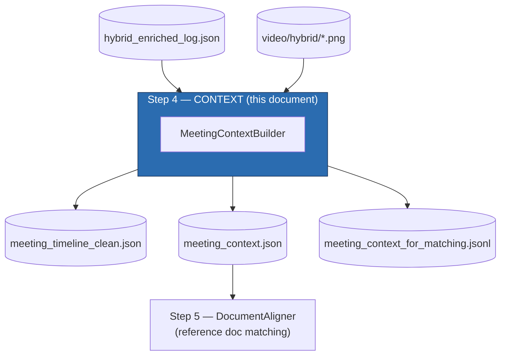
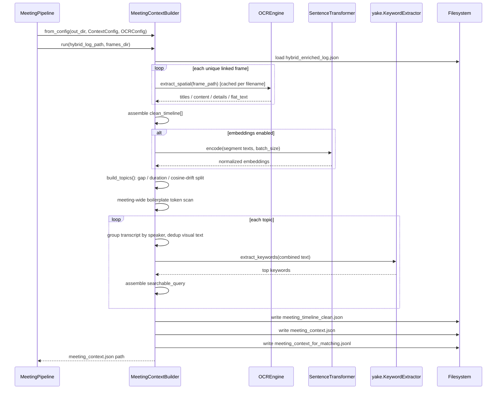

# Step 4: Context Building (`MeetingContextBuilder`)

Source: `src/meeting_pipeline/context_builder.py`
Supporting modules: `ocr_engine.py`, `text_cleaning.py`, `timecodes.py`
Config: `ContextConfig` + `OCRConfig` (`src/meeting_pipeline/config.py`)
Orchestrated by: `MeetingPipeline.build_context()` (`src/meeting_pipeline/pipeline.py`)

## 1. Purpose

`MeetingContextBuilder` turns the flat, chunk-level frame log from Step
1-3 (`hybrid_enriched_log.json`) into **topic-level multimodal context** —
the richest artifact in the whole pipeline, and the one Step 5 actually
searches against. It does two largely independent jobs:

1. **OCR + spatial decomposition** of every linked keyframe — extract the
   visible text, and classify each piece of text as a title, body content,
   or a small detail/nav label based on its geometry.
2. **Topic clustering** of the chronological speech-segment timeline —
   group segments into topic blocks using silence gaps, a duration cap, and
   (optionally) semantic drift in the transcript itself.

Everything is then aggregated per topic — transcript grouped by speaker,
deduplicated visual text, YAKE keywords — into one `searchable_query` string
per topic, which is the actual input `DocumentAligner` embeds and scores
against reference documents in Step 5.

## 2. Where it fits in the pipeline



## 3. Dependencies

### Python packages

| Package | Import site | Used for |
|---|---|---|
| **sentence-transformers** | `from sentence_transformers import SentenceTransformer` (lazy, inside `__init__`, only if `embeddings_enabled`) | Encodes every speech segment (`"{speaker}: {transcript}"`) into a normalized embedding vector, used purely for the semantic-drift topic-split signal. |
| **yake** | `import yake` (lazy, inside `__init__`) | Unsupervised keyword extraction — pulls representative keywords per topic from the combined transcript + visual-title/content text. |
| **numpy** (`np`) | module top | Cosine similarity via `np.dot`, and the running centroid update (`(mean*n + emb) / (n+1)`, then renormalized) during topic clustering. |

Both `sentence-transformers` and `yake` are optional at runtime: if either
fails to load, the builder logs a warning and degrades gracefully rather
than crashing (see §12).

### Internal (sibling modules)

| Module | Symbol(s) | Used for |
|---|---|---|
| `config.py` | `ContextConfig`, `OCRConfig` | Every tunable value for clustering, boilerplate filtering, keyword extraction, and (via `OCRConfig`) OCR backend/spatial-layout tuning. |
| `ocr_engine.py` | `OCREngine` | Auto-fallback OCR backend wrapper (rapid → paddle → easy → tesseract → none) and `SpatialLayoutExtractor`'s titles/content/details decomposition. See `docs/ocr_backends.md` for the backend chain in full. |
| `text_cleaning.py` | `clean_ocr_text`, `is_meaningful_text`, `normalize_whitespace` | Strips screen-recording noise from raw OCR output and gates out text that's mostly noise. |
| `timecodes.py` | `format_clock` | `83 -> "01:23"` display-time formatting for segment/topic start/end times. |

Note: `MeetingContextBuilder` never imports an OCR backend package
(`rapidocr-onnxruntime`, `easyocr`, ...) directly — that's entirely
encapsulated inside `OCREngine`, itself constructed lazily via `OCRConfig`.

## 4. Configuration

### `ContextConfig`

| Field | Default | Purpose |
|---|---|---|
| `topic_gap_sec` | `30.0` | Silence gap since the previous segment that forces a new topic. |
| `max_topic_duration_sec` | `120.0` | Cumulative topic duration cap that forces a split even without a gap. |
| `topic_similarity_threshold` | `0.68` | Cosine similarity floor against the running topic centroid; below this, a semantic split is triggered. |
| `min_segments_before_semantic_split` | `2` | A topic needs at least this many segments before the semantic-drift check can split it — prevents a still-forming topic fracturing on its second segment. |
| `embeddings_enabled` | `True` | Master switch for semantic topic-boundary detection. |
| `embedding_model` | `"all-MiniLM-L6-v2"` | Sentence-transformers model used for segment embeddings. |
| `embedding_device` | `"cpu"` | `"cpu"`/`"cuda"`. |
| `embedding_batch_size` | `32` | Batch size for `SentenceTransformer.encode(...)`. |
| `boilerplate_document_frequency` | `0.65` | Any OCR token appearing on more than this fraction of a meeting's frames is treated as static UI chrome. |
| `min_frames_for_boilerplate` | `4` | Minimum OCR'd frame count before boilerplate detection even runs (too few frames = statistically meaningless). |
| `dedup_jaccard_threshold` | `0.65` | Token-set Jaccard similarity above which two visual text lines are treated as duplicates within a topic. |
| `keyword_ngram_size` | `2` | YAKE n-gram size. |
| `keyword_candidates` | `6` | YAKE candidate pool size (`top=`). |
| `max_keywords` | `8` | Cap on keywords kept per topic. |
| `max_visual_content_lines` | `15` | Cap on visual content lines folded into `searchable_query`. |
| `searchable_query_max_chars` | `6000` | Hard cap on the final `searchable_query` string length. |

### Relevant `OCRConfig` fields (full reference in `docs/ocr_backends.md` / `docs/configuration.md`)

`backend`, `enabled`, `spatial_mode` (`"spatial_hierarchical"` vs `"flat"`),
plus every `SpatialLayoutExtractor` geometry threshold
(`title_height_multiplier`, `detail_height_multiplier`, `title_band_ratio`,
`sidebar_x_ratio`, margin-crop fields) — these are consumed by `OCREngine`,
not by `MeetingContextBuilder` directly.

## 5. Important code sections

### 5.1 Frame-aligned timeline + OCR — `build_frame_aligned_timeline()`

```python
ocr_cache: dict[str, dict] = {}
for entry in audio_entries:
    for ff in entry["frame_files"]:
        if ff in ocr_cache:
            spatial_data = ocr_cache[ff]                       # reuse — same file, no re-OCR
        elif Path(frames_dir, ff).exists():
            if self.spatial_ocr_mode == "spatial_hierarchical":
                spatial_data = self.ocr_engine.extract_spatial(str(fp))
            else:
                ocr_text = clean_ocr_text(self.ocr_engine.extract(str(fp)), ...)
                spatial_data = {"titles": [], "content": [ocr_text], "details": [], "flat_text": ocr_text}
            ocr_cache[ff] = spatial_data
```

The `ocr_cache` keyed by filename is important: because `HybridExtractor`
links duplicate/unchanged screens to the *same* frame file across many
chunks, OCR only actually runs once per unique image, no matter how many
speech segments reference it. Each segment becomes one `clean_timeline`
entry (`seg_000`, `seg_001`, ...) carrying its transcript, speaker, and the
list of OCR'd frames aligned to it.

### 5.2 Topic clustering — `build_topics()`

```python
embeddings = self.embed_model.encode([f"{s['speaker']}: {s['transcript']}" for s in clean_timeline], ...)

for idx, seg in enumerate(clean_timeline):
    gap = seg["start_sec"] - cur[-1]["end_sec"]
    dur = seg["end_sec"] - cur_start
    split = False
    if gap > self.topic_gap_sec:
        split = True
    elif dur > self.max_topic_duration_sec:
        split = True
    elif embeddings is not None:
        sim = float(np.dot(embeddings[idx], cur_mean))
        if sim < self.topic_similarity_threshold and len(cur) >= self.min_segments_before_semantic_split:
            split = True
        if not split:
            n = len(cur)
            cur_mean = (cur_mean * n + embeddings[idx]) / (n + 1)   # running centroid
            cur_mean = cur_mean / (norm(cur_mean) + 1e-9)            # renormalize
```

Three **independent** split conditions, checked in strict priority order
per segment — the first one that fires wins, and only if none fire does the
segment get folded into the running centroid:

1. **Temporal gap** — silence since the last segment exceeds `topic_gap_sec`.
2. **Duration cap** — the topic has simply run too long.
3. **Semantic drift** — the segment's embedding has drifted away from the
   topic's running mean embedding, but only once the topic is "established"
   (`min_segments_before_semantic_split`).

If embeddings failed to load, `embeddings` is `None` and the algorithm
silently degrades to time-based-only grouping (conditions 1-2 only).

### 5.3 Boilerplate filtering + per-topic aggregation — `build_matchable_context()`

```python
# Meeting-wide token document frequency
for tok, cnt in token_frame_counts.items():
    if (cnt / total_ocr_frames) > self.boilerplate_document_frequency:
        boilerplate_tokens.add(tok)

def _clean_and_dedup(text_list):
    for t in text_list:
        filtered = [w for w in t.split() if w.lower() not in boilerplate_tokens]
        cleaned_t = " ".join(filtered).strip()
        if not is_meaningful_text(cleaned_t):
            continue
        cur_set = token_set(cleaned_t)
        if not any(jaccard(cur_set, seen) > self.dedup_jaccard_threshold for seen in seen_sets):
            uniq.append(cleaned_t)   # keep only if not near-duplicate of something already kept
    return uniq
```

This is the general mechanism (documented in `docs/ocr_backends.md`) that
makes hardcoding specific noise strings unnecessary: any OCR token that
shows up on more than `boilerplate_document_frequency` (65% by default) of
*all* the meeting's OCR'd frames — a recurring participant name, a
persistent app title bar — is stripped from every topic's visual text,
computed once across the whole meeting before per-topic aggregation begins.
`_clean_and_dedup` then also removes near-duplicate lines within a topic via
Jaccard token-set similarity, so the same visible text sampled across
several adjacent frames of an unchanged slide doesn't get repeated.

Per topic, the transcript is grouped by speaker (not chronologically
interleaved), keywords are extracted from the combined transcript + visual
titles/content, and everything is assembled into one `searchable_query`
string:

```python
searchable_parts = [agg_transcript]
if clean_titles:  searchable_parts.append(f"[VISUAL_TITLES]: {' | '.join(clean_titles)}")
if clean_content: searchable_parts.append(f"[VISUAL_CONTENT]: {' | '.join(clean_content[:max_visual_content_lines])}")
if keywords:      searchable_parts.append(f"[KEYWORDS]: {', '.join(keywords)}")
searchable = "\n".join(searchable_parts)[:searchable_query_max_chars]
```

### 5.4 Save — `save()`

Writes three files (see §11 for schemas): `meeting_timeline_clean.json`
(segment-level, with an OCR-backend/embedding-usage `meta` block),
`meeting_context.json` (the full per-topic context list — Step 5's input),
and `meeting_context_for_matching.jsonl` (a slim, one-line-per-topic search
index carrying only `topic_id`/`start_sec`/`end_sec`/`searchable_query`/
`frame_count`/`primary_frame`).

### 5.5 Stage entry point — `run()`

```python
def run(self, log_path, frames_dir=None):
    clean, gaps = self.build_frame_aligned_timeline(log_path, frames_dir)
    topics = self.build_topics(clean)
    ctx = self.build_matchable_context(topics)
    return self.save(clean, gaps, ctx)
```

Called by `MeetingPipeline.build_context()` (`pipeline.py:121-136`) via
`MeetingContextBuilder.from_config(output_dir, self.config.context, self.config.ocr)`.

## 6. Detailed flow diagram

```mermaid
flowchart TD
    Start(["MeetingPipeline.build_context(hybrid_log, out_dir)"]) --> Load["load hybrid_enriched_log.json\nsort by start_sec"]
    Load --> Split["split source==audio (with text)\nvs source==gap"]

    Split --> PerSeg["for each audio entry / linked frame"]
    subgraph OCRLoop["build_frame_aligned_timeline()"]
        direction TB
        PerSeg --> Cached{"frame file\nalready OCR'd\nthis run?"}
        Cached -- yes --> Reuse["reuse cached spatial_data"]
        Cached -- no --> ModeCheck{"spatial_ocr_mode?"}
        ModeCheck -- spatial_hierarchical --> Spatial["OCREngine.extract_spatial()\n-> titles / content / details"]
        ModeCheck -- flat --> Flat["OCREngine.extract() + clean_ocr_text()\n-> flat content only"]
        Spatial --> Cache["cache by filename"]
        Flat --> Cache
        Reuse --> SegOut["append frame to segment"]
        Cache --> SegOut
    end
    SegOut --> Timeline["clean_timeline[]  (one entry per speech segment)"]

    Timeline --> Embed{"embeddings_enabled\nand model loaded?"}
    Embed -- yes --> BatchEncode["batch-encode all segments\n(SentenceTransformer)"]
    Embed -- no --> NoEmbed["embeddings = None"]
    BatchEncode --> Cluster
    NoEmbed --> Cluster["build_topics(): per segment, check\n1) gap > topic_gap_sec\n2) duration > max_topic_duration_sec\n3) cosine(seg, centroid) < threshold\n   (only if len(topic) >= min_segments)"]
    Cluster -->|any true| NewTopic["start new topic"]
    Cluster -->|none true| UpdateCentroid["append to topic,\nupdate running centroid mean"]
    NewTopic --> Topics["topics[]  (list of segment groups)"]
    UpdateCentroid --> Topics

    Topics --> DocFreq["meeting-wide OCR token\ndocument-frequency scan\n-> boilerplate_tokens"]
    DocFreq --> PerTopic["for each topic"]
    subgraph Aggregate["build_matchable_context()"]
        direction TB
        PerTopic --> GroupSpeaker["group transcript by speaker"]
        GroupSpeaker --> CollectVisual["collect unique frames,\ntitles/content/details"]
        CollectVisual --> CleanDedup["_clean_and_dedup():\nstrip boilerplate tokens,\nis_meaningful_text gate,\nJaccard near-dup removal"]
        CleanDedup --> Keywords["YAKE keyword extraction\n(transcript + visual text)"]
        Keywords --> Searchable["assemble searchable_query\n(transcript + titles + content + keywords)"]
    end
    Searchable --> Contexts["contexts[]  (per-topic dicts)"]

    Contexts --> Save["save():\nmeeting_timeline_clean.json\nmeeting_context.json\nmeeting_context_for_matching.jsonl"]
    Save --> Done(["return (p1, p2, p3) paths"])

    style Done fill:#2f855a,color:#fff
```



## 7. Sequence diagram



## 8. Spatial OCR decomposition (brief)

`OCREngine.extract_spatial()` delegates to `SpatialLayoutExtractor.decompose()`
(full detail in `docs/ocr_backends.md` / `docs/architecture.md`): each OCR
bounding box's relative height and screen position determines whether it's
classified a **title** (significantly taller than the frame's median text
height, or in the top banner zone), a **detail** (small, far-left column —
nav/sidebar labels), or generic **content**. Only RapidOCR and PaddleOCR
return per-box polygons needed for this; EasyOCR/Tesseract fall back to
putting everything in `content`.

## 9. Output artifacts

### `meeting_timeline_clean.json`
```json
{
  "meta": { "total_segments": 42, "ocr_backend": "rapid", "embedding_used": true, "spatial_ocr_mode": "spatial_hierarchical" },
  "timeline": [ { "segment_id": "seg_000", "start_sec": 0.0, "end_sec": 12.4, "speaker": "Alice",
                  "transcript": "...", "frames": [ { "file": "frame_00_00_02.png", "ocr_text": "...",
                  "spatial_titles": [...], "spatial_content": [...], "spatial_details": [...] } ], "frame_count": 1 } ],
  "gap_visuals": [ /* raw gap-sourced log entries, unprocessed */ ]
}
```

### `meeting_context.json` (Step 5's input)
```json
[ { "topic_id": "topic_000", "start_sec": 0.0, "end_sec": 118.3, "start_time": "00:00", "end_time": "01:58",
    "speakers": ["Alice", "Bob"], "segment_ids": ["seg_000", "seg_001"],
    "transcript_aggregated": "Alice: ...\nBob: ...",
    "visual_hierarchy": { "titles": [...], "content": [...], "details": [...] },
    "visual_texts": [...], "keywords": [...], "frames": [...], "frame_count": 3,
    "primary_frame": "frame_00_00_02.png", "searchable_query": "..." } ]
```

### `meeting_context_for_matching.jsonl`
One line per topic: `{topic_id, start_sec, end_sec, searchable_query, frame_count, primary_frame}` — a slim search index (not currently backed by any vector DB — see the roadmap note in `docs/architecture.md`).

## 10. Error handling / graceful degradation

| Failure | Behavior |
|---|---|
| `sentence-transformers` fails to load | Caught in `__init__`; `use_embedding = False`, logged as a warning — topic clustering falls back to gap/duration-only splitting. |
| `yake` unavailable | Caught in `__init__` at debug level; `kw_extractor = None` — topics simply get `keywords: []`. |
| Per-topic keyword extraction raises | Caught inside `build_matchable_context`'s try/except, logged at debug, that topic just gets no keywords rather than aborting the whole run. |
| OCR backend unavailable entirely | Handled inside `OCREngine` itself (falls back through rapid → paddle → easy → tesseract → none) — `MeetingContextBuilder` just receives empty spatial results. |

## 11. Key architectural properties

- **OCR is the expensive step, and it's cached hard**: the per-filename
  `ocr_cache` means a screen that stays static across dozens of speech
  chunks is OCR'd exactly once per run.
- **Boilerplate filtering is meeting-relative, not hardcoded**: no specific
  string (a person's name, an app title) is ever special-cased in code —
  the document-frequency threshold discovers it per-meeting.
- **Three-tier graceful degradation**: full spatial+semantic+keyword
  context → OCR-less/embedding-less transcript-only context, with no hard
  dependency failing the whole stage at any point.
- **Resumable**: `MeetingPipeline` checks `meeting_context.json`'s existence
  for `resume=True`, and requires `hybrid_enriched_log.json` to exist first
  (`pipeline.py:227-232`), raising `ArtifactNotFoundError` otherwise.
