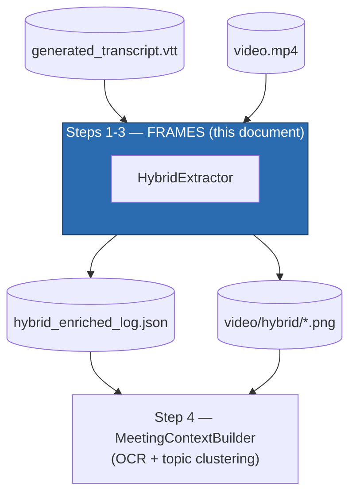
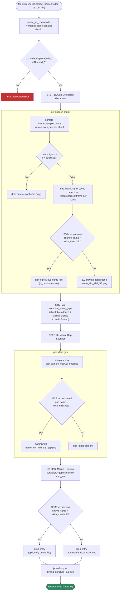
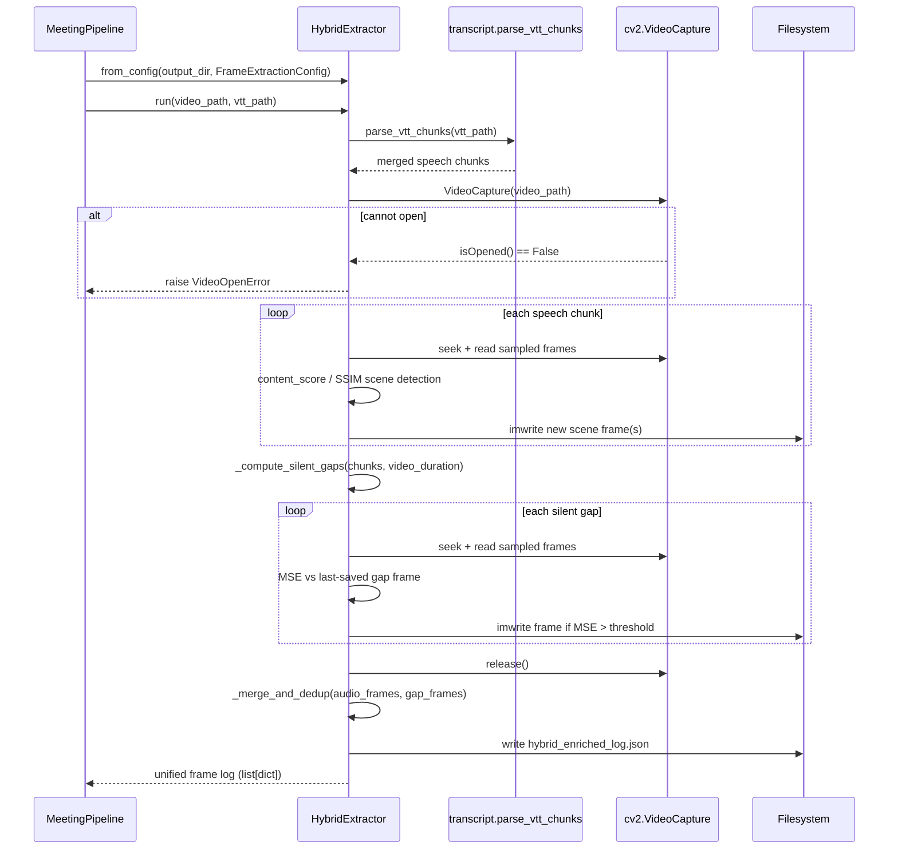

# Steps 1-3: Frame Extraction (`HybridExtractor`)

Source: `src/meeting_pipeline/hybrid_extractor.py`
Supporting modules: `image_metrics.py`, `transcript.py`, `timecodes.py`
Config: `FrameExtractionConfig` (`src/meeting_pipeline/config.py`)
Orchestrated by: `MeetingPipeline.extract_frames()` (`src/meeting_pipeline/pipeline.py`)

## 1. Purpose

`HybridExtractor` turns the transcript produced in Step 0 plus the raw video
into a curated set of keyframes — the slide/code/document screens that were
actually visible while each thing was said — and a unified JSON log linking
every speech chunk (and every silent gap) to the frame(s) relevant to it.

It is a purpose-built alternative to naive fixed-interval sampling (e.g.
"grab a frame every 5 seconds"), which either wastes frames on redundant
static screens or misses a slide change that happens mid-interval. Instead
it runs **two independent extraction passes**, each anchored to a different
signal, then merges and deduplicates the result:

1. **Audio-anchored extraction** — sample frames *within* each speech
   chunk's time range, because content on screen usually correlates with
   what's being said about it.
2. **Visual gap scanner** — sample *silent* windows between speech chunks
   (and after the last word, to the end of the video), because presenters
   often leave a slide or terminal on screen silently, or scroll/type
   without narrating.

## 2. Where it fits in the pipeline



## 3. Dependencies

### Python packages

| Package | Import site | Used for |
|---|---|---|
| **opencv-python** (`cv2`) | `hybrid_extractor.py` top, `image_metrics.py` top | Video I/O (`cv2.VideoCapture`, `.set(CAP_PROP_POS_MSEC, ...)`, `.read()`), colorspace conversion (`cvtColor`), resizing, Gaussian blur, Sobel/Laplacian filters, and `imwrite` for saving keyframe PNGs. This is the only stage that opens/decodes the video file itself. |
| **numpy** (`np`) | both modules | Backing array math for MSE (`np.mean((g1-g2)**2)`), the SSIM computation, and general elementwise ops. |

### Internal (sibling modules)

| Module | Symbol(s) | Used for |
|---|---|---|
| `config.py` | `FrameExtractionConfig` | Every tunable threshold (SSIM/MSE cutoffs, chunk/gap timing, sample counts). |
| `errors.py` | `VideoOpenError` | Raised if OpenCV can't open the video file at all. |
| `image_metrics.py` | `compute_ssim`, `content_score`, `laplacian_variance` | Pure numpy/OpenCV functions — no video I/O — kept separate so they're independently unit-testable on synthetic arrays. |
| `timecodes.py` | `format_hms` | `"83 -> 0:01:23"` formatting for gap-scanner timestamps and the persisted `start_time_format`/`end_time_format` log fields. |
| `transcript.py` | `parse_vtt_chunks` | Parses the Step 0 VTT into merged same-speaker speech chunks — the temporal anchor for the audio-anchored pass. |

There is **no OCR or embedding dependency** in this stage at all — it is
purely a computer-vision/frame-selection problem; text extraction happens
later, in Step 4.

## 4. Configuration (`FrameExtractionConfig`)

| Field | Default | Purpose |
|---|---|---|
| `ssim_threshold` | `0.92` | Structural-similarity cutoff (above = "same screen") used for **cross-chunk** dedup and the **final merge** dedup pass. |
| `mse_threshold` | `500.0` | Mean-squared-error cutoff (above = "different enough to save") used by the **gap scanner**. |
| `chunk_gap_seconds` | `5.0` | Passed through to `parse_vtt_chunks` — max silent gap between captions still merged into one speech chunk. |
| `max_chunk_duration_seconds` | `30.0` | Passed through to `parse_vtt_chunks` — caps how long one merged speech chunk can span. |
| `min_gap_duration_seconds` | `5.0` | Silent windows shorter than this are never scanned (not worth sampling). |
| `gap_sample_interval_seconds` | `5.0` | Sampling cadence inside a silent gap. |
| `frame_sample_count` | `5` | Candidate frames sampled evenly across each speech chunk before content/scene filtering. |
| `content_score_threshold` | `0.15` | Below this composite score, a sample is classified "webcam-only" and dropped. |
| `intra_chunk_ssim_threshold` | `0.85` | Below this SSIM (compared to the current scene's best frame), a *new* visual scene is declared within one chunk. |
| `delete_deduped_frames` | `False` | If true, physically deletes the PNG file when the final merge pass drops it as a duplicate (rather than just dropping the log entry). |

## 5. Important code sections

### 5.1 Content scoring — "is this a slide, or a face?" (`image_metrics.content_score`)

```python
def content_score(frame) -> float:
    gray = ... # resized to 320x180 grayscale
    lap_var = laplacian_variance(gray)                     # edge/text sharpness
    uniform_ratio = count_nonzero(bright_mask) / gray.size  # near-white background ratio
    text_line_density = mean(abs(Sobel_horizontal(gray)))   # horizontal text-row edges
    return 0.5*min(lap_var/1000, 1) + 0.3*uniform_ratio + 0.2*min(text_line_density/10, 1)
```

A pure-OpenCV heuristic, no ML model: slides/code/documents tend to have
sharp edges (text), large near-white regions (backgrounds), and dense
horizontal edge lines (rows of text) — a webcam view of a person's face
scores low on all three. This is the gate that keeps webcam-only chunks out
of the frame log entirely.

### 5.2 Intra-chunk scene detection — `_extract_chunk_frames()`

```python
for gray, frame, ts, lap_var in content_samples:
    if scene_best_gray is None:
        scene_best_* = gray, frame, ts, lap_var
    else:
        ssim_val = compute_ssim(scene_best_gray, gray)
        if ssim_val < self.intra_chunk_ssim_threshold:
            scenes.append((scene_best_frame, scene_best_ts))   # commit the finished scene
            scene_best_* = gray, frame, ts, lap_var             # start a new one
        elif lap_var > scene_best_lap:
            scene_best_* = gray, frame, ts, lap_var             # same scene, but sharper — keep it
```

Within one speech chunk's evenly-sampled candidates, this single pass both
detects scene changes (SSIM drop = new slide) *and* picks the sharpest frame
per scene (highest Laplacian variance = least motion blur/least
in-transition). A chunk can therefore emit more than one saved frame if the
presenter changed slides mid-sentence.

### 5.3 Cross-chunk dedup — `_extract_audio_anchored()`

```python
first_frame, first_ts = scene_frames[0]
first_gray = ...
is_dup = last_gray is not None and compute_ssim(last_gray, first_gray) > self.ssim_threshold
if is_dup:
    saved_fnames = [last_file] if last_file else []   # link to the SAME file, don't re-save
else:
    for scene_img, scene_ts in scene_frames:
        cv2.imwrite(...)                              # save each new scene as frame_HH_MM_SS.png
    last_gray, last_file = first_gray, saved_fnames[0]
```

Before saving anything new, this chunk's first scene is compared against the
*previous* chunk's saved first frame. If the screen hasn't changed since the
last chunk, the new entry just links to the existing file (`is_duplicate:
true`, `frame_files: [last_file]`) instead of writing a redundant PNG.

### 5.4 Gap boundaries — `_compute_silent_gaps()`

```python
for chunk in chunks:
    gap_start, gap_end = prev_end, chunk["start_sec"]
    if gap_end - gap_start >= self.min_gap_duration_seconds:
        gaps.append((gap_start, gap_end))
    prev_end = chunk["end_sec"]
if transcript_end_sec - prev_end >= self.min_gap_duration_seconds:
    gaps.append((prev_end, transcript_end_sec))   # trailing silence to end-of-video
```

`transcript_end_sec` is the **video's total duration**, not the last spoken
word's timestamp — deliberately, per the module docstring, "slides/code are
often left on screen silently after a meeting's last words."

### 5.5 Gap scanning via MSE — `_scan_gaps()`

```python
gray = cvtColor(resize(frame, (320,180)), GRAY).astype(float32)
mse = mse_threshold + 1 if last_gray is None else mean((gray - last_gray) ** 2)
if mse > self.mse_threshold:
    cv2.imwrite(..., "_gap.png")
    last_gray = gray
```

Unlike the audio-anchored pass (which uses SSIM), gap scanning uses the
cheaper MSE metric, and — notably — inlines the pixel-diff math rather than
calling `image_metrics.compute_mse` (that helper reprocesses both images
every call; here `last_gray` is deliberately cached across loop iterations
so each step only resizes/converts the *new* frame). The first sample in
every gap is always saved (`mse = threshold + 1`) since there's no prior
frame to compare against yet.

### 5.6 Final merge + dedup — `_merge_and_dedup()`

```python
combined = sorted(audio_frames + gap_frames, key=lambda x: x["start_sec"])
for entry in combined:
    ...
    gray = cvtColor(resize(cv2.imread(fpath), (640,360)), GRAY)
    if last_gray is not None and compute_ssim(last_gray, gray) > self.ssim_threshold:
        continue   # drop as duplicate (optionally deleting the file)
    last_gray = gray
    deduped.append(entry)
```

The two independently-produced frame lists are interleaved chronologically,
then one more SSIM pass removes any *residual* duplicate that slipped
through — e.g. a gap-scanned frame that happens to match the audio-anchored
frame right before or after it. An entry with no linked frame at all (e.g.
the meeting's very first chunk was webcam-only) is passed through untouched
rather than crashing on a `None` path — a fix noted in the changelog for a
latent bug in the original implementation.

### 5.7 Stage entry point — `run()`

```python
def run(self, video_path, vtt_path) -> list[dict]:
    chunks = self._parse_transcript(vtt_path)
    cap = cv2.VideoCapture(video_path)
    if not cap.isOpened():
        raise VideoOpenError(video_path)
    audio_frames = self._extract_audio_anchored(cap, chunks, self.hybrid_dir)
    gaps = self._compute_silent_gaps(chunks, video_duration)
    gap_frames = self._scan_gaps(cap, gaps, self.hybrid_dir)
    cap.release()
    unified = self._merge_and_dedup(audio_frames, gap_frames, self.hybrid_dir)
    json.dump(unified, open(hybrid_enriched_log.json, "w"))
    return unified
```

This is what `MeetingPipeline.extract_frames()` calls into
(`pipeline.py:111-119`), via `HybridExtractor.from_config(output_dir, self.config.frames)`.

## 6. Detailed flow diagram



## 7. Sequence diagram



## 8. The three dedup layers

A key architectural point: there isn't one dedup step, there are **three**,
each catching a different kind of redundancy:

| Layer | Method | Catches |
|---|---|---|
| Intra-chunk | SSIM, `intra_chunk_ssim_threshold` | Scene changes *within* one speech chunk (presenter flips a slide mid-sentence). |
| Cross-chunk | SSIM, `ssim_threshold` | The same static screen persisting across consecutive speech chunks. |
| Final merge | SSIM, `ssim_threshold` | A static screen spanning a silence gap plus the speech either side of it (the audio-anchored and gap-scanner passes independently "discover" the same screen). |

## 9. Output artifacts

### `video/hybrid/*.png`
Saved keyframes, named `frame_HH_MM_SS.png` (audio-anchored) or
`frame_HH_MM_SS_gap.png` (gap-scanned).

### `hybrid_enriched_log.json`
A flat list of entries, one per speech chunk (`source: "audio"`) or sampled
gap window (`source: "gap"`), sorted by `start_sec` after the merge pass.
Representative fields:

```json
{
  "source": "audio",
  "start_sec": 42.1,
  "end_sec": 47.8,
  "transcript_start": "00:00:42",
  "transcript_end": "00:00:47",
  "speaker": "Alice",
  "text": "so if you look at this diagram...",
  "frame_file": "frame_00_00_43.png",
  "frame_files": ["frame_00_00_43.png"],
  "frame_timestamps_sec": [43.2],
  "scene_count": 1,
  "content_frames_found": 3,
  "is_duplicate": false,
  "start_time_format": "0:00:42",
  "end_time_format": "0:00:47"
}
```

Consumed entirely by `MeetingContextBuilder` (Step 4), which reads every
`frame_file`/`frame_files` entry to run OCR against the actual PNGs in
`video/hybrid/`.

## 10. Error handling

| Condition | Exception | Notes |
|---|---|---|
| OpenCV cannot open the video file | `VideoOpenError` | Raised immediately in `run()`, before any frame extraction is attempted — no partial log is written. |

## 11. Key architectural properties

- **Two independent, complementary signals**: audio-anchored sampling
  favors precision (frames near what's being discussed); the gap scanner
  favors recall (catches silent screen time the transcript says nothing
  about). Neither alone is sufficient.
- **No ML model**: every scoring function (`content_score`, SSIM, MSE,
  Laplacian variance) is hand-rolled classical OpenCV/numpy — this stage has
  zero model-loading cost and no GPU dependency.
- **Resumable**: `MeetingPipeline` checks `hybrid_enriched_log.json`'s
  existence to decide whether to skip this stage under `resume=True`; it
  requires `generated_transcript.vtt` to exist first (`pipeline.py:216-221`),
  raising `ArtifactNotFoundError` otherwise.
- **Deliberate over fixed-interval sampling**: the whole point of the hybrid
  design (per `docs/architecture.md`) is avoiding both wasted frames on
  static screens and missed frames on fast slide changes that a naive
  "every N seconds" sampler would produce.
