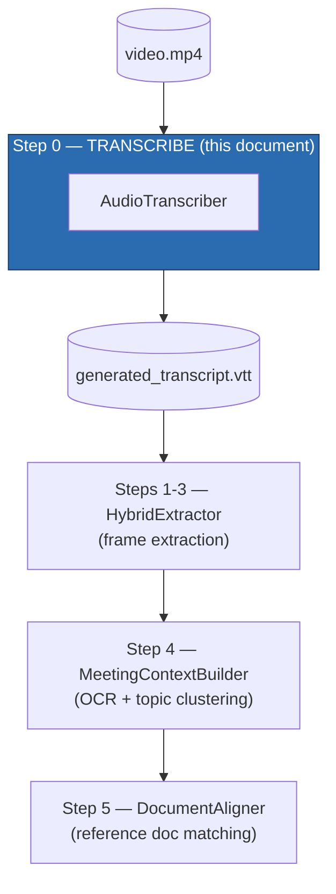
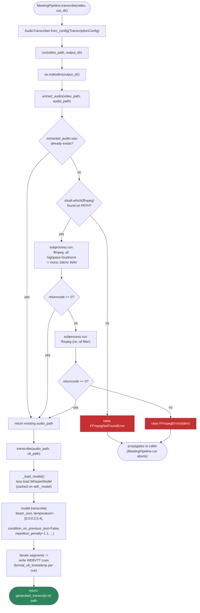
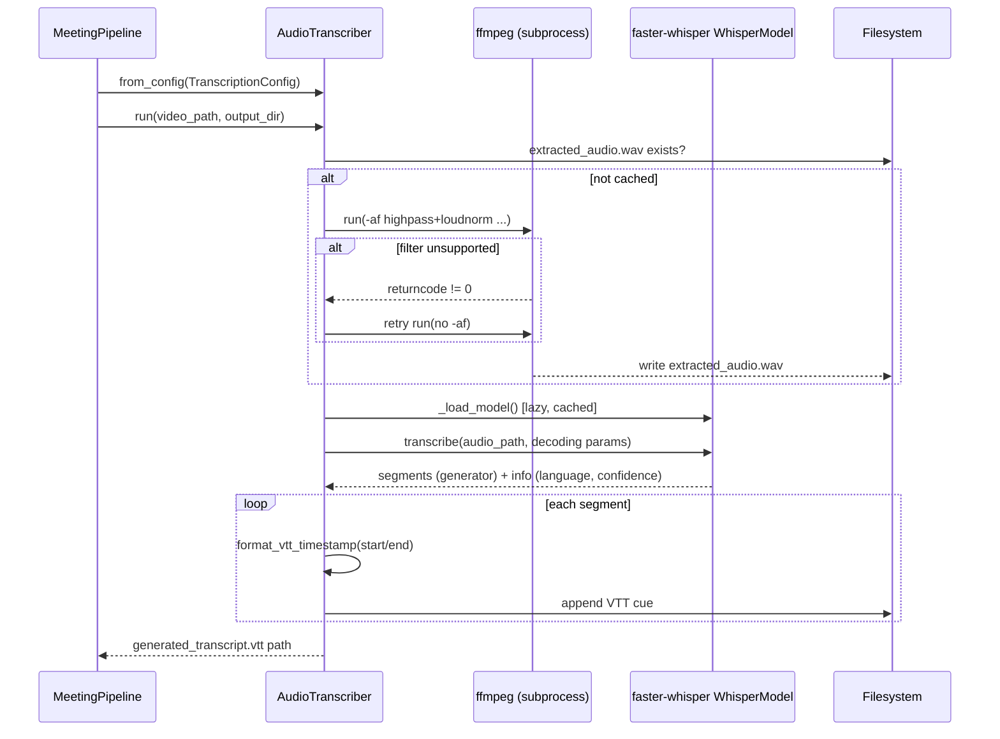

# Step 0: Transcription (`AudioTranscriber`)

Source: `src/meeting_pipeline/audio_transcriber.py`
Config: `TranscriptionConfig` (`src/meeting_pipeline/config.py`)
Orchestrated by: `MeetingPipeline.transcribe()` (`src/meeting_pipeline/pipeline.py`)

## 1. Purpose

`AudioTranscriber` is the first stage of the pipeline. It takes a raw meeting
recording (`video.mp4`) and produces a time-aligned WebVTT transcript
(`generated_transcript.vtt`), which every later stage treats as ground truth
for "what was said when." It does exactly two things, in order:

1. **Extract audio** from the video file via the `ffmpeg` CLI, as mono
   16kHz PCM WAV.
2. **Transcribe that audio** locally using `faster-whisper`, writing the
   result as a WebVTT file with millisecond-precision cue timestamps.

No cloud API is involved — Whisper runs entirely on the local CPU (or GPU,
if configured). This is also the only stage that touches the raw audio
signal; nothing downstream re-reads the VTT file's timestamps as anything
other than an intermediate artifact.

## 2. Where it fits in the pipeline



## 3. Dependencies

### External / system

| Dependency | Type | Used for |
|---|---|---|
| **ffmpeg** (CLI binary) | External process, must be on `PATH` | Demuxes the video container, applies an optional audio filter, resamples/downmixes, and writes a `.wav` file. Invoked via `subprocess.run(...)`, never linked as a Python library. |

### Python packages

| Package | Import site | Used for |
|---|---|---|
| **faster-whisper** | `from faster_whisper import WhisperModel` (lazy, inside `_load_model`) | Loads a local Whisper speech-recognition model and runs `model.transcribe(...)` to produce timestamped segments + detected language/confidence. |
| `os`, `shutil`, `subprocess` (stdlib) | module top | `os` for path joins/existence checks/dir creation; `shutil.which` to verify `ffmpeg` is installed before trying to run it; `subprocess.run` to invoke `ffmpeg`. |

### Internal (sibling modules)

| Module | Symbol | Used for |
|---|---|---|
| `config.py` | `TranscriptionConfig` | Supplies every tunable default (model size, decoding params, ffmpeg filter, etc.) via `AudioTranscriber.from_config(...)`. |
| `errors.py` | `FFmpegNotFoundError`, `FFmpegError` | Typed exceptions raised when `ffmpeg` is missing from `PATH` or exits non-zero. |
| `timecodes.py` | `format_vtt_timestamp` | Converts a float-seconds timestamp (e.g. `83.5`) into the exact `HH:MM:SS.mmm` string WebVTT cues require. |

Note the **lazy import** of `faster_whisper` inside `_load_model()` rather
than at module top — this is the same pattern used package-wide
(`meeting_pipeline/__init__.py`, `pipeline.py`) so that simply importing
`meeting_pipeline` or constructing an `AudioTranscriber` never pulls in
`faster-whisper` (and transitively `torch`/`ctranslate2`) until a
transcription is actually requested.

## 4. Configuration (`TranscriptionConfig`)

| Field | Default | Purpose |
|---|---|---|
| `model_size` | `"base.en"` | Whisper model variant (`tiny.en`…`large-v3`). English-specialized `.en` models trade language flexibility for accuracy on English speech. |
| `device` | `"cpu"` | `"cpu"` or `"cuda"`. |
| `compute_type` | `"default"` | CTranslate2 quantization/precision mode; `"default"` is the safest cross-platform choice on CPU. |
| `language` | `"en"` | Spoken language hint passed to Whisper. |
| `initial_prompt` | `None` | Optional domain/vocabulary priming text. `None` resolves to `TranscriptionConfig.DEFAULT_INITIAL_PROMPT`, a neutral meeting primer — this avoids biasing transcription toward one contributor's specific domain. |
| `beam_size` | `5` | Beam search width during decoding. |
| `temperatures` | `(0.0, 0.2, 0.4)` | Multi-temperature fallback: Whisper retries a segment at a higher temperature if the greedy/low-temperature decode looks unreliable — reduces hallucinated text on unclear audio. |
| `condition_on_previous_text` | `False` | Disables cross-segment conditioning — prevents one hallucinated segment from contaminating the next (a known Whisper failure mode on silence/noise). |
| `repetition_penalty` | `1.1` | Discourages the decoder from looping on repeated phrases. |
| `vad_filter` | `False` | Voice-activity-detection pre-filtering (off by default). |
| `word_timestamps` | `False` | Per-word timing (off — this pipeline only needs segment-level timestamps). |
| `ffmpeg_path` | `"ffmpeg"` | Executable name/path used for both the `PATH` check and the subprocess call. |
| `audio_filter` | `"highpass=f=80,loudnorm"` | ffmpeg audio filter graph: high-pass filters out sub-80Hz rumble, `loudnorm` normalizes perceived loudness. |
| `audio_sample_rate` | `16000` | Resample target — 16kHz is what Whisper's architecture expects. |
| `audio_channels` | `1` | Downmix to mono. |

Together, `beam_size` / `temperatures` / `condition_on_previous_text` /
`repetition_penalty` form what the module docstring calls **"anti-hallucination
decoding settings"** — a known failure mode of Whisper is inventing plausible
but false text during silence, background noise, or unclear speech, and this
combination is tuned specifically to suppress that.

## 5. Important code sections

### 5.1 Lazy model loading — `_load_model()`

```python
def _load_model(self):
    if self._model is None:
        from faster_whisper import WhisperModel
        self._model = WhisperModel(self.model_size, device=self.device, compute_type=self.compute_type)
    return self._model
```

The model is only instantiated on first use and cached on `self._model` —
constructing an `AudioTranscriber` is cheap; the (potentially multi-hundred-MB)
model download/load only happens when `transcribe()` is actually called.

### 5.2 Audio extraction with filter fallback — `extract_audio()`

```python
def extract_audio(self, video_path: str, audio_path: str) -> str:
    if os.path.exists(audio_path):
        return audio_path                      # idempotent / resumable

    if shutil.which(self.ffmpeg_path) is None:
        raise FFmpegNotFoundError(self.ffmpeg_path)

    cmd_filtered = [ffmpeg, "-y", "-i", video_path, "-vn", "-af", self.audio_filter, *codec_args, audio_path]
    result = subprocess.run(cmd_filtered, capture_output=True, text=True)
    if result.returncode != 0:
        # some ffmpeg builds lack libebur128 (needed for loudnorm) — retry without the filter
        cmd_basic = [ffmpeg, "-y", "-i", video_path, "-vn", *codec_args, audio_path]
        result_basic = subprocess.run(cmd_basic, capture_output=True, text=True)
        if result_basic.returncode != 0:
            raise FFmpegError(f"ffmpeg failed:\n{result_basic.stderr}")
    return audio_path
```

Three notable design decisions here:
- **Idempotent early return**: if `extracted_audio.wav` already exists, it's
  reused rather than regenerated — this is what lets `MeetingPipeline`'s
  `resume=True` skip work across reruns.
- **Existence check before subprocess**: `shutil.which` fails fast with a
  clear, actionable error (`FFmpegNotFoundError` includes install
  instructions per OS) instead of a cryptic `FileNotFoundError` from
  `subprocess.run`.
- **Graceful filter fallback**: some `ffmpeg` builds are compiled without
  `libebur128`, which `loudnorm` needs. Rather than hard-failing, a second,
  filter-less extraction is attempted before giving up.

### 5.3 Transcription + VTT serialization — `transcribe()`

```python
segments, info = model.transcribe(
    audio_path,
    language=language,
    initial_prompt=prompt,
    beam_size=self.beam_size,
    temperature=list(self.temperatures),
    condition_on_previous_text=self.condition_on_previous_text,
    repetition_penalty=self.repetition_penalty,
    word_timestamps=self.word_timestamps,
    vad_filter=self.vad_filter,
)

with open(vtt_path, "w", encoding="utf-8") as f:
    f.write("WEBVTT\n\n")
    for i, seg in enumerate(segments):
        start = format_vtt_timestamp(seg.start)
        end = format_vtt_timestamp(seg.end)
        text = seg.text.strip()
        f.write(f"{i}\n{start} --> {end}\n{text}\n\n")
```

`faster-whisper`'s `segments` is a lazy generator — decoding actually
happens as the `for` loop iterates it while writing the file, not inside the
`model.transcribe(...)` call itself. Each segment becomes one WebVTT cue,
numbered and timestamped with `format_vtt_timestamp` (`timecodes.py`), whose
exact `HH:MM:SS.mmm` output format is load-bearing — later stages
(`transcript.py`'s `parse_vtt_chunks`) parse this same format back out.

### 5.4 Stage entry point — `run()`

```python
def run(self, video_path, output_dir, language="en", initial_prompt=None) -> str:
    os.makedirs(output_dir, exist_ok=True)
    audio_path = os.path.join(output_dir, "extracted_audio.wav")
    vtt_path = os.path.join(output_dir, "generated_transcript.vtt")
    self.extract_audio(video_path, audio_path)
    self.transcribe(audio_path, vtt_path, language=language, initial_prompt=initial_prompt)
    return vtt_path
```

This is the method `MeetingPipeline.transcribe()` calls
(`pipeline.py:104-109`), via `AudioTranscriber.from_config(self.config.transcription)`.
It fixes the two output filenames (`extracted_audio.wav`,
`generated_transcript.vtt`) that the rest of the pipeline expects to find at
those exact paths under `output_dir`.

## 6. Detailed flow diagram



## 7. Sequence diagram



## 8. Output artifacts

| File | Format | Consumed by |
|---|---|---|
| `extracted_audio.wav` | Mono, 16kHz, PCM16 WAV | Nothing downstream — intermediate only, kept mainly so `extract_audio` can be skipped on rerun. |
| `generated_transcript.vtt` | Standard WebVTT (`WEBVTT` header + numbered `HH:MM:SS.mmm --> HH:MM:SS.mmm` cues) | `HybridExtractor` (Steps 1-3), via `transcript.py`'s `parse_vtt_chunks`, which merges consecutive same-speaker cues into speech chunks. This is the **only** stage that reads the VTT file — every later stage operates on richer JSON structures derived from it. |

## 9. Error handling summary

| Condition | Exception | Message includes |
|---|---|---|
| `ffmpeg` not on `PATH` | `FFmpegNotFoundError` | Per-OS install commands (`winget`/`brew`/`apt`). |
| `ffmpeg` exits non-zero on both filtered and basic extraction attempts | `FFmpegError` | Raw `stderr` from the failed basic-extraction attempt. |

Both are subclasses of `MeetingPipelineError` (`errors.py`), so a caller can
catch either narrowly or via the common base class.

## 10. Key architectural properties

- **Resumable**: `extract_audio` short-circuits if its output file already
  exists, which combined with `MeetingPipeline`'s `resume=True` lets a full
  rerun skip transcription entirely if `generated_transcript.vtt` is present.
- **Fails fast and clearly**: the `ffmpeg` PATH check happens before any
  subprocess is spawned, and both custom exceptions carry actionable,
  OS-specific remediation text.
- **No hidden global state**: `apply_thread_env()` (thread-pool env vars
  needed to avoid a known CTranslate2 deadlock) is *not* called automatically
  here — it's the CLI's/caller's responsibility to call it before importing
  anything heavy, per the package-wide rule that a library never mutates
  `os.environ` on import.
- **Deterministic output contract**: the VTT's exact timestamp format
  (`format_vtt_timestamp`) is treated as a stable, load-bearing interface
  because `transcript.py` parses it back out downstream — not an incidental
  formatting detail.
