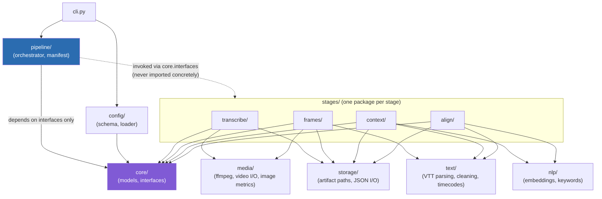

# Architecture

## Layering and dependency direction

The rule that makes this scaffold maintainable/testable/extensible is a
single dependency-direction constraint: **dependencies only point inward,
toward `core`.** `core` (data models + interfaces) depends on nothing else
in the package. Shared infra (`media`/`text`/`nlp`/`storage`) depends only on
`core` and the standard library/third-party packages. Each stage depends on
`core` + shared infra, never on another stage. `pipeline/` depends on `core`
interfaces to invoke stages, never on a stage's concrete class. `cli.py`
depends on `pipeline/` + `config/`.

Why this matters in practice: `pipeline/orchestrator.py` should be
constructible and testable with **fake** stage implementations (simple
classes that satisfy `core.interfaces.PipelineStage` and return canned
data) -- it never needs a real Whisper model or a real video file to test
its resume/stage-selection logic, because it only ever talks to stages
through their interface, never their concrete class.

## Why a shared `media`/`text`/`nlp` layer instead of per-stage duplication

In the original `meeting_pipeline`, `OCREngine` is imported by both
`context_builder.py` and `document_aligner.py` -- one implementation, two
call sites, which is exactly the pattern this scaffold generalizes on
purpose:

- `media/` holds anything that touches raw audio/video/pixels
  (`ffmpeg_runner.py`, `video_capture.py`, `image_metrics.py`) -- used by
  `transcribe/` and `frames/`.
- `text/` holds anything that parses or cleans text
  (`vtt_parser.py`, `cleaning.py`, `timecodes.py`) -- used by `frames/` and
  `context/`.
- `nlp/` holds anything that talks to an embedding model or keyword
  extractor (`embeddings.py`, `keywords.py`) -- used by `context/` and
  `align/`, and importantly defines **one** `EmbeddingProvider` interface so
  both stages configure/swap the embedding model identically instead of each
  stage constructing its own `SentenceTransformer` inline.

A new capability that spans stages (e.g. a persisted vector index, a
different OCR backend, a cloud embedding provider) is added to the relevant
shared package once, behind its existing interface, and every stage that
uses that interface picks it up automatically.

## Module map: `meeting_pipeline` -> `meeting_pipeline_2`

Use this to know where to port each piece of proven logic from.

| Original (`../meeting_pipeline/src/meeting_pipeline/`) | New location | Notes |
|---|---|---|
| `pipeline.py` (`MeetingPipeline`, `Stage`, `PipelineResult`) | `pipeline/orchestrator.py`, `pipeline/manifest.py` | Split: stage-running/resume logic vs. manifest serialization. |
| `config.py` | `config/schema.py` (dataclasses), `config/loader.py` (JSON/CLI merging) | Same 6 sections; split definition from loading. |
| `errors.py` | `errors.py` | Same typed exceptions. |
| `logging_utils.py` | `logging_utils.py` | Same `apply_thread_env`/`configure_logging` split. |
| `cli.py` | `cli.py` | Same argparse structure, now calling `pipeline/` + `config/`. |
| `audio_transcriber.py` | `stages/transcribe/service.py` + `stages/transcribe/whisper_backend.py` | ffmpeg call moves to `media/ffmpeg_runner.py` (shared). |
| `hybrid_extractor.py` | `stages/frames/service.py` + `audio_anchored.py` + `gap_scanner.py` + `dedup.py` | One file per extraction phase (was one 425-line class). |
| `image_metrics.py` | `media/image_metrics.py` | Same pure functions, unchanged responsibility. |
| `transcript.py` | `text/vtt_parser.py` | Same responsibility. |
| `timecodes.py` | `text/timecodes.py` | Same responsibility. |
| `text_cleaning.py` | `text/cleaning.py` | Same responsibility. |
| `ocr_engine.py` (`OCREngine` + `SpatialLayoutExtractor`) | `stages/context/ocr/engine.py` (fallback chain) + `spatial_layout.py` + `backends/*.py` (one file per backend) | Was one file mixing backend selection, all 4 backend call sites, and spatial decomposition. |
| `context_builder.py` | `stages/context/service.py` + `topic_clustering.py` + `boilerplate_filter.py` | Split: OCR/timeline assembly, topic-boundary algorithm, and document-frequency noise filtering are three separable concerns. |
| `document_aligner.py` (ingestion) | `stages/align/ingestion/*.py` (one file per format) | Was one class with a `_ingest_*` method per format. |
| `document_aligner.py` (scoring) | `stages/align/scoring.py` | Semantic/keyword/OCR-overlap signal functions, isolated as pure functions of their inputs -- directly unit-testable, no model loading required. |
| `document_aligner.py` (two-stage orchestration) | `stages/align/service.py` | Calls `ingestion/` + `scoring.py` + the shared `nlp.EmbeddingProvider`. |

Full behavioral reference for every algorithm listed above (SSIM/MSE
thresholds, topic-split conditions, alignment scoring formulas, OCR spatial
decomposition) lives in `../meeting_pipeline/docs/` -- that documentation
describes the *behavior* to preserve; this scaffold only changes *where the
code implementing that behavior lives*.

## Extension points (why this shape is "extensible")

| Want to... | Do this |
|---|---|
| Add a 5th OCR backend | Add `stages/context/ocr/backends/my_backend.py` implementing the backend protocol from `backends/base.py`; register it in `engine.py`'s priority list. Nothing else changes. |
| Support a new reference-document format | Add `stages/align/ingestion/my_format_ingester.py` implementing `ingestion/base.py`'s `DocumentIngester` protocol; register its extension in `stages/align/service.py`'s dispatch table. |
| Swap the embedding provider (e.g. a different local model, or a future hosted one) | Implement `core.interfaces.EmbeddingProvider` in `nlp/embeddings.py` (or a new module) and wire it in via `config/`. `context/` and `align/` never construct a model directly, so neither needs to change. |
| Add a persisted vector index | Add it as a new module behind `storage/` or a new `nlp/vector_store.py` implementing an interface `align/service.py` depends on -- an additive change, not a rewrite of alignment logic. |
| Run a single stage in isolation for debugging | Every stage's `service.py` is constructible and runnable independently of `pipeline/orchestrator.py`, exactly like the original's per-stage CLI subcommands. |
